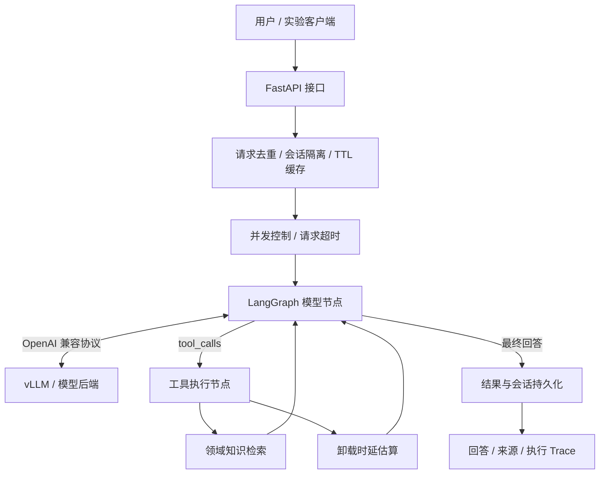

# Vehicular Agent Infra

### 基于 LangGraph 与 vLLM 的车路协同 LLM Agent 推理系统

将领域知识检索、卸载时延估算与模型推理组织成一条可追踪的 Agent 执行链路，提供从本地演示、API 调用到模型服务接入和并发评估的完整开发流程。

**个人项目 · 覃毅（Yi Qin）**  
`Python` · `LangGraph` · `vLLM` · `FastAPI` · `SQLite` · `Docker`

[快速开始](#快速开始) · [系统架构](#系统架构) · [模型接入](#接入-vllm-模型服务) · [性能评估](#性能评估) · [技术文档](#技术文档)

## 项目背景

车载边缘计算中的任务卸载决策需要同时理解任务需求、节点队列与网络条件。单轮问答难以把资料依据、计算工具和多步骤执行组织在一起；接入模型之后，还需要处理重复请求、会话状态、超时与性能测量。

本项目围绕这一场景构建 Agent 服务：使用 LangGraph 编排模型与工具，通过统一接口连接本地推理后端，将知识检索、时延估算、会话持久化和链路评估整合到同一套代码中。

## 核心设计

- **可扩展编排：** 将模型决策与工具执行拆分为状态图节点，通过条件路由完成多步骤调用；工具结果回传模型，并通过调用轮数限制收敛执行过程。
- **领域知识检索：** 对 MEC 文档进行分块与向量表示，结合中文二元词、英文词法特征和余弦相似度返回相关片段及来源；支持切换 SentenceTransformer 语义向量。
- **请求可靠性：** 使用异步并发控制、整请求超时和分类重试管理下游调用；通过请求 ID 校验、会话串行化与 SQLite 事务保存结果，支持重复请求重放。
- **上下文感知缓存：** 缓存键关联模型、语料版本、历史上下文与当前问题，配合 TTL 管理复用范围，使缓存结果与实际对话条件保持一致。
- **评估与定位：** 记录模型、工具与请求耗时，分别提供 Agent 端到端评估和模型流式评估，输出逐请求记录、延迟分位数、协议完成率与 GPU 采样数据。

## 系统架构



一次请求依次完成 **接收与校验 → 上下文加载 → 模型决策 → 工具执行 → 结果反馈 → 回答持久化**。执行 Trace 随响应返回，便于从具体请求定位到模型和工具节点。

## 快速开始

运行环境：**Python 3.10+**。在项目根目录执行以下命令。

```powershell
python -m venv .venv
.\.venv\Scripts\Activate.ps1
python -m pip install -e ".[dev]"

$env:BACKEND='mock'
vai demo
vai serve
```

Linux 使用 `source .venv/bin/activate` 激活环境。`mock` 模式使用固定模型响应，运行知识检索、工具反馈、会话与 API 链路；`openai` 模式连接实际模型服务。

启动后打开 [交互式 API 文档](http://127.0.0.1:8000/docs)，或在另一个终端执行：

```powershell
python examples/client.py
```

响应包含 `answer`、`request_id`、`session_id`、`cache_hit`、`replayed` 和 `trace`。首次执行可查看工具调用记录；再次提交相同请求 ID 和内容，可观察 `replayed=true`。

### 自定义领域知识

将 Markdown 文档放入 `src/vai/data/`，重启服务后即可检索。也可通过 `DOCUMENTS` 指定独立知识目录。

默认使用 TF-IDF 向量检索；语义检索的安装与模型配置见 [部署文档](docs/DEPLOYMENT.md)。检索结果包含源文件、字符偏移和相似度，便于核对回答依据。

## 接入 vLLM 模型服务

在 Linux / WSL2 的 vLLM 环境中运行：

```bash
bash deploy/serve_vllm.sh
```

启动脚本默认使用 `Qwen/Qwen3-1.7B`，开启工具调用解析，服务端口为 `8001`，模型服务名为 `local-model`。模型与资源参数集中在脚本中配置。

确认模型服务的 `/v1/models` 可访问后，在应用终端设置：

```powershell
$env:BACKEND='openai'
$env:LLM_BASE_URL='http://127.0.0.1:8001/v1'
$env:LLM_MODEL='local-model'

vai demo --question '检索任务卸载资料，说明为什么不能只选择计算速度最快的节点。'
vai serve
```

后端需支持 `tools/tool_calls`。设备环境、模型版本和显存参数的配置方法见 [部署文档](docs/DEPLOYMENT.md)。

## API 接口

| 接口 | 用途 |
|---|---|
| `POST /v1/agent` | 执行一次带会话上下文的 Agent 请求 |
| `POST /v1/agent/events` | 通过 SSE 返回受理、执行 Trace 和最终结果等生命周期事件 |
| `GET /metrics` | 查看请求、缓存、工具调用与失败累计数 |
| `GET /health` | 查看应用进程状态与后端配置 |

请求示例：

```json
{
  "question": "车辆任务卸载如何兼顾排队时延和负载均衡？",
  "session_id": "mec-session-01",
  "request_id": "request-001",
  "use_cache": true
}
```

设置 `API_KEY` 后，业务接口使用 Bearer 鉴权。完整字段、返回结构与错误码见 [API 文档](docs/API.md)。

## 性能评估

通过两条评估路径区分应用编排开销与模型生成开销：

```powershell
# Agent 完整执行链路
vai benchmark --mode agent --requests 50 --concurrency 4 --output artifacts/agent-c4

# 模型文本流：TTFT 与输出吞吐
vai benchmark --mode model-stream --requests 50 --concurrency 2 --output artifacts/model-c2
```

| 输出 | 内容 |
|---|---|
| `requests.csv` | 每次请求的成功状态、耗时、工具调用与错误类型 |
| `summary.json` | P50/P95、协议完成率、吞吐与运行配置 |
| `gpu.csv` | 可用时记录设备级显存与利用率采样 |

模型性能评估使用 `BACKEND=openai`；TTFT 取首个非空文本增量，token 吞吐取后端 `usage`。并发、输入长度与指标定义见 [评估文档](docs/EVALUATION.md)。

## 测试与复现路线

仓库包含 **7 项自动测试**，覆盖工具调用、时延估算、请求去重、会话与缓存、超时、工具循环、鉴权及后端协议处理。

```powershell
python -m pytest
python scripts/verify.py
```

| 步骤 | 操作 | 验收结果 |
|---|---|---|
| 1. 本地演示 | `vai demo` | 返回领域资料、来源及工具 Trace |
| 2. 服务调用 | `vai serve` + `examples/client.py` | API 响应与重复请求重放 |
| 3. 模型接入 | 启动 vLLM 并切换后端 | 模型完成工具决策与结果反馈 |
| 4. 并发评估 | `vai benchmark` | 逐请求 CSV 与指标摘要 |
| 5. 重复验证 | `scripts/verify.py` | 自动测试与执行日志 |

验证日志与摘要输出到 `artifacts/verification/`；随仓库提供的运行记录位于 `evidence/`，记录对应后端和执行条件。

## 目录结构

```text
src/vai/       服务、状态图、模型适配、检索与工具实现
src/vai/data/  车载边缘计算领域知识
deploy/        vLLM 模型服务启动脚本
examples/      API 调用示例
tests/         自动测试
scripts/       重复验证入口
evidence/      测试日志与实验记录
docs/          架构、接口、部署与评估说明
```

## 技术文档

| 文档 | 内容 |
|---|---|
| [架构与设计](docs/ARCHITECTURE.md) | 状态流转、工具机制、存储设计与源码阅读路线 |
| [部署指南](docs/DEPLOYMENT.md) | 本地运行、Docker、vLLM 与语义检索配置 |
| [API 说明](docs/API.md) | 请求参数、响应与错误码 |
| [评估方法](docs/EVALUATION.md) | 并发设置、指标定义与对照实验 |

## 开源与许可

工作流基于 [LangGraph](https://github.com/langchain-ai/langgraph)，模型服务接入 [vLLM](https://github.com/vllm-project/vllm) 的兼容接口。应用层业务编排、检索、工具、存储与评估代码维护在本仓库。

采用 [MIT License](LICENSE)。依赖归属、参考版本与开发说明见 [THIRD_PARTY_NOTICES.md](THIRD_PARTY_NOTICES.md)。
