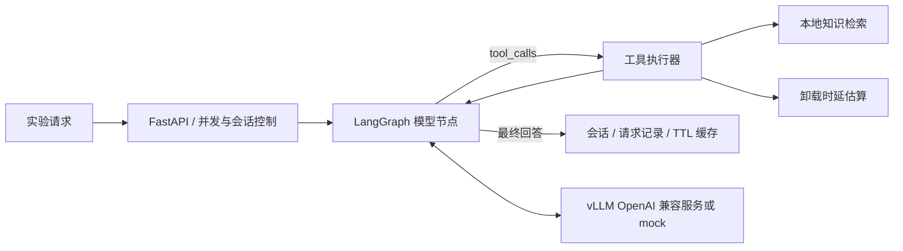

# Vehicular Agent Infra

**面向车路协同计算实验的 LangGraph Agent：知识检索、卸载时延估算、工具反馈与可观测推理服务。**

维护者：覃毅（Yi Qin）。这是结合车载边缘计算、任务卸载和负载均衡背景编写的个人研究原型，代码由 Codex 辅助开发。
LangGraph 负责状态图，vLLM 作为可替换的外部推理后端；本仓库新增业务编排、工具、检索、缓存、接口与测量代码。

## 能做什么

- 条件路由与有界工具循环：模型 → 工具 → 模型，参数校验、工具错误反馈及调用轮数限制。
- 自建中文 MEC 知识库：Markdown 分块、中文二元词与英文词 TF-IDF 向量检索、余弦相似度和源文件引用；可选 sentence-transformers 语义向量。
- 异步并发闸门、排队在内的整请求超时、可重试 HTTP 错误、SQLite 会话与请求去重。
- 有效期缓存绑定模型、语料版本与历史上下文；相同 request_id 重试返回原结果，冲突返回 409。
- FastAPI、生命周期 SSE、链路 trace；压测分别测 Agent 端到端时延与模型文本流 TTFT，保存原始 CSV 和 GPU 总显存采样。



## 5 分钟离线运行

在本项目根目录打开终端。建议为三个项目分别建立虚拟环境。

```powershell
python -m venv .venv
.\.venv\Scripts\Activate.ps1
python -m pip install -e ".[dev]"
python -m pytest
vai demo
vai serve
```

Linux 使用 `source .venv/bin/activate`。PowerShell 激活受限时，可直接用 `.\.venv\Scripts\python.exe -m vai.cli demo`。
默认 `BACKEND=mock`，不需要 GPU、模型文件或 API Key。`demo` 应显示 MOCK 标记、search_knowledge 工具 trace 与检索来源。
服务文档位于 [http://127.0.0.1:8000/docs](http://127.0.0.1:8000/docs)。`.env.example` 是变量说明文件，程序不自动加载 .env。

```powershell
$body = @{question='车辆任务卸载如何考虑队列拥塞？'; session_id='mec-01'; request_id='demo-001'} | ConvertTo-Json
Invoke-RestMethod http://127.0.0.1:8000/v1/agent -Method Post -ContentType 'application/json; charset=utf-8' -Body ([Text.Encoding]::UTF8.GetBytes($body))
```

## 切换本地模型

本机检测到 RTX 5060 Ti 8GB。提供的起始配置选择较小文本模型；vLLM 应在独立 Linux/WSL2 环境配置，详见 [部署](docs/DEPLOYMENT.md)。
仓库未包含模型权重，本次交付没有运行 vLLM GPU 推理。先按 `deploy/serve_vllm.sh` 启动并检查 `/v1/models`，再设置：

```powershell
$env:BACKEND='openai'
$env:LLM_BASE_URL='http://127.0.0.1:8001/v1'
$env:LLM_MODEL='local-model'
vai demo
```

模型必须支持 tools/tool_calls；仅支持文本聊天的后端不足以运行完整工具循环。

## 复现实验

```powershell
vai benchmark --mode agent --requests 50 --concurrency 4 --output artifacts/agent-c4
vai benchmark --mode model-stream --requests 50 --concurrency 2 --output artifacts/model-c2
```

更改输入长度用 `--prompt`；更多测量约定见 [实验说明](docs/EVALUATION.md)。`evidence/` 是本次运行保留的离线协议记录，不能当作 LLM 的推理吞吐。
`model-stream` 报告第一个非空文本增量的客户端延迟，按后端 usage 统计 token，缺少 usage 时留空。`/v1/agent/events` 是生命周期事件，不承诺逐 token 输出。

## 阅读与扩展

| 目标 | 入口 |
|---|---|
| 业务与上游分工、源码调用链 | [架构](docs/ARCHITECTURE.md) |
| 完整请求与错误码 | [API](docs/API.md) |
| Windows / Linux / Docker / 模型服务 | [部署](docs/DEPLOYMENT.md) |
| 已验证内容与简历表述边界 | [证据](docs/EVIDENCE.md) |
| 导入自己的 GitHub 仓库 | [导入指南](docs/GITHUB_IMPORT.md) |

当前 SQLite 和锁按单进程设计；使用一个 Uvicorn worker。已完成对话持久化，尚未实现运行中图节点的崩溃续跑或分布式限流。
检索默认是词法 TF-IDF 向量，语义 embedding 为可选模式；没有集成 RAGFlow、修改 vLLM 内核或完成领域模型微调。

来源：[LangGraph 官方仓库](https://github.com/langchain-ai/langgraph)、[vLLM 工具调用文档](https://docs.vllm.ai/en/stable/features/tool_calling/)。
完整来源快照、许可证及 AI 辅助说明见 [THIRD_PARTY_NOTICES.md](THIRD_PARTY_NOTICES.md)。

完整重复验证：`python scripts/verify.py`；生成日志位于 artifacts/verification，不覆盖随包 evidence。
